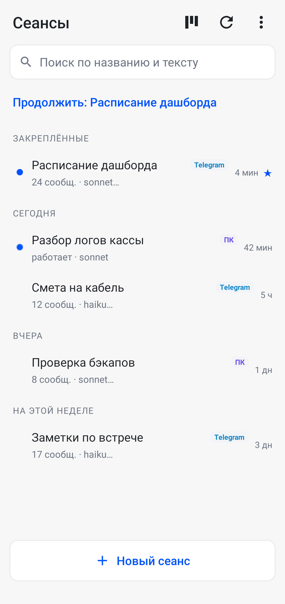

# Hermes Mobile (Android)

**Русский** · [English](#english)

Нативный Android-клиент для **Hermes Agent** — агента, который живёт на вашем
собственном сервере. Не обёртка над браузером: приложение само ходит в HTTP API
Hermes и держит WebSocket, поэтому у него нормальные push-уведомления, работа в
фоне и настоящая лента чата, а не iframe.

```
Android (Kotlin)  ──HTTP + WS──▶  Hermes webapp API (:9120)  ──▶  agent, sessions, tools
                  ──HTTP──────▶  Kanban WebUI (опционально)
```

<p align="center">
  
  
  
</p>

Скриншоты — не макеты: их рисует `ScreenshotTest`, который на JVM разворачивает
настоящие layout'ы приложения и сохраняет PNG (`./gradlew testDebugUnitTest
--tests ru.evgen.hermes.ScreenshotTest`). Данные в них выдуманы, переписки
пользователя в репозиторий не попадают.

## Что умеет

- **Сессии** — список с фильтром по проекту, архив, поиск по всей истории,
  отметки прочитанного.
- **Чат** — потоковый ответ по WebSocket (`assistant.delta`), инструменты и
  результаты видны в ленте, markdown и код с подсветкой, картинки и файлы.
- **Управление прогоном** — отправить, остановить, «steer» (вместо остановки
  дописать агенту указание по ходу), очередь из нескольких сообщений.
- **Слэш-команды** и смена модели/профиля прямо из чата.
- **Уведомления** — три канала: статус «работаю» (LOW), ответ (DEFAULT), запрос
  ввода (HIGH). Плюс Live Update на Android 16+ и виджет на домашнем экране.
- **Фон** — опциональный foreground-сервис досматривает прогон и присылает
  ответ, даже если приложение закрыто.
- **Файлы** — отправка любых файлов, не только картинок.
- **Kanban** — доска из [Kanban WebUI](https://github.com/PriuS2/HermesKanban)
  в мобильном виде: колонки как вкладки, перемещение карточки долгим нажатием.
- **Голосовой ввод** в композер.
- **Самообновление (по желанию)** — читает `/version.json` рядом с webapp и ставит
  новый APK (через Shizuku без экрана установщика, если он есть). **Выключено по
  умолчанию**: APK приходит с твоего же сервера, а не из магазина, поэтому включение
  — осознанный шаг, и диалог об этом предупреждает.

## Требования

1. **Hermes Agent** на сервере, версия **0.23.x** (проверено на 0.23.3). В
   `~/.hermes/config.yaml`:

   ```yaml
   webapp:
     enabled: true
     host: 0.0.0.0
     port: 9120
     public_url: https://hermes.example.com
   ```

2. **HTTPS снаружи.** Приложение требует `https://` (Android блокирует cleartext
   по умолчанию). Подойдёт Caddy/nginx/NPM с сертификатом.

3. **Логин.** Приложение логинится той же учётной записью, что и веб-панель
   Hermes; пароль не хранится, остаются только cookies.

Kanban-раздел опционален: без токена он просто не откроется.

## Сборка

Нужны JDK 17 и Android SDK 36 (`compileSdk 36`, `minSdk 24`, `targetSdk 34`).

```bash
./gradlew assembleDebug        # debug-сборка, ставится рядом с release
./gradlew testDebugUnitTest    # 13 классов тестов на JVM (Robolectric)
```

Release без ключа соберётся **неподписанным** — это нормально для форка.
Свой ключ кладётся в `keystore.properties` в корне:

```properties
storeFile=my-release.jks
storePassword=…
keyAlias=…
keyPassword=…
```

Ключ и `keystore.properties` в git не попадают (см. `.gitignore`).

Сменить `applicationId`, не трогая код:

```bash
./gradlew assembleRelease -PappId=dev.example.hermes
```

### Релизы

`.github/workflows/build.yml` на каждый push гоняет тесты и собирает debug APK
артефактом. `.github/workflows/release.yml` на тег `v*` собирает release и
прикладывает APK + sha256 к черновику релиза. Чтобы APK был подписан, в
Settings → Secrets → Actions нужны два секрета:

| Секрет | Значение |
|---|---|
| `ANDROID_KEYSTORE_BASE64` | `base64 -w0 my-release.jks` |
| `ANDROID_KEYSTORE_PROPERTIES` | содержимое `keystore.properties` |

Без них job остаётся зелёным и отдаёт неподписанный APK.

## Первый запуск

Экран входа спрашивает три вещи: адрес сервера (`https://hermes.example.com`),
логин и пароль. Адрес запоминается в настройках приложения; сменить его можно
там же, в меню.

## Чего здесь нет

Приложение — клиент, а не сервер: без запущенного Hermes оно бесполезно. Оно
также **не** использует OpenAI-совместимый API (`:8642`), а работает с webapp-API
панели (`:9120`) — это тот же интерфейс, что у веб-панели и TUI.

## Совместимость

`/api/*` панели Hermes — внутренний контракт, а не публичный API. Он меняется
между версиями агента, поэтому:

| Hermes Agent | Приложение |
|---|---|
| 0.23.x | работает (проверено 0.23.3) |
| новее | не проверено; сначала смотрите `CHANGELOG` Hermes |

Если после обновления Hermes приложение перестало грузить сессии — почти всегда
дело в изменившейся ручке, а не в телефоне.

## Лицензия

MIT — см. [LICENSE](LICENSE). Проект не связан с Nous Research; Hermes Agent
распространяется отдельно под MIT.

---

## English

**[Русский](#hermes-mobile-android)**

Native Android client for a self-hosted **[Hermes Agent](https://hermes-agent.nousresearch.com/docs)** —
an agent that lives on your own server. Not a browser wrapper: the app talks to the
Hermes HTTP API directly and keeps a WebSocket open, so it gets real push
notifications, real background work and a real chat feed instead of an iframe.

```
Android (Kotlin)  ──HTTP + WS──▶  Hermes webapp API (:9120)  ──▶  agent, sessions, tools
                  ──HTTP──────▶  Kanban WebUI (optional)
```

<a name="english-screens"></a>
<p align="center">
  
  
  
</p>

These are not mockups. `ScreenshotTest` inflates the app's real layouts on the JVM
and writes the PNGs (`./gradlew testDebugUnitTest --tests
ru.evgen.hermes.ScreenshotTest`). The data in them is invented — no user
transcripts are in this repository.

### Features

- **Sessions** — project filter, archive, full-history search, read marks.
- **Chat** — streaming answers over WebSocket (`assistant.delta`), tool calls and
  their results inline, markdown and syntax highlighting, images and files.
- **Run control** — send, stop, *steer* (inject an instruction into a run that is
  already going instead of killing it), queue several messages.
- **Slash commands**, model and profile switching straight from the chat.
- **Notifications** — three channels: "working" status (LOW), answer (DEFAULT),
  input request (HIGH). Plus Live Updates on Android 16+ and a home-screen widget.
- **Background** — optional foreground service that follows a run to completion
  and delivers the answer even if the app is closed.
- **Files** — send any file, not just images.
- **Kanban** — a [Kanban WebUI](https://github.com/PriuS2/HermesKanban) board in
  mobile form: columns as tabs, drag a card by long-pressing it.
- **Voice input** in the composer.
- **Self-update (opt-in)** — reads `/version.json` next to the webapp and installs
  the new APK (silently through Shizuku when it is available). **Off by default**:
  the APK comes from your own server rather than from an app store, so turning it on
  is a deliberate step, and the dialog says so before it is enabled.

### Requirements

1. **Hermes Agent** on the server, version **0.23.x** (verified on 0.23.3). In
   `~/.hermes/config.yaml`:

   ```yaml
   webapp:
     enabled: true
     host: 0.0.0.0
     port: 9120
     public_url: https://hermes.example.com
   ```

2. **HTTPS on the outside.** The app requires `https://` — Android blocks
   cleartext by default. Caddy, nginx or NPM with a certificate all work.

3. **A login.** The app signs in with the same account as the Hermes web panel.
   The password is never stored; only cookies are.

The Kanban section is optional — without a token it simply does not open.

<a name="build"></a>
### Build

JDK 17 and Android SDK 36 are required (`compileSdk 36`, `minSdk 24`,
`targetSdk 34`).

```bash
./gradlew assembleDebug        # debug build, installs alongside release
./gradlew testDebugUnitTest    # 13 test classes on the JVM (Robolectric)
```

A release build without a keystore comes out **unsigned** — that is a normal
outcome for a fork. To sign it, put `keystore.properties` in the project root:

```properties
storeFile=my-release.jks
storePassword=…
keyAlias=…
keyPassword=…
```

Neither the keystore nor `keystore.properties` is tracked by git (see
`.gitignore`).

Change the `applicationId` without touching code:

```bash
./gradlew assembleRelease -PappId=dev.example.hermes
```

#### Releases

`.github/workflows/build.yml` runs the tests and uploads a debug APK as an
artifact on every push. `.github/workflows/release.yml` builds a signed release
on a `v*` tag and attaches the APK plus its sha256 to a draft release. Signing in
CI needs two secrets under Settings → Secrets → Actions:

| Secret | Value |
|---|---|
| `ANDROID_KEYSTORE_BASE64` | `base64 -w0 my-release.jks` |
| `ANDROID_KEYSTORE_PROPERTIES` | the contents of `keystore.properties` |

Without them the job stays green and produces an unsigned APK.

### First run

The login screen asks for three things: the server address
(`https://hermes.example.com`), a login and a password. The address is remembered
in the app's settings and can be changed there later from the menu.

### What this is not

The app is a client, not a server: without a running Hermes it does nothing. It
also does **not** use the [OI]-compatible API (`:8642`) — it talks to the panel's
webapp API (`:9120`), the same interface the web panel and the TUI use.

### Compatibility

`/api/*` on the Hermes panel is an internal contract, not a public API. It moves
between agent versions, therefore:

| Hermes Agent | App |
|---|---|
| 0.23.x | works (verified on 0.23.3) |
| newer | untested; read the Hermes `CHANGELOG` first |

If sessions stop loading right after a Hermes upgrade, it is almost always a
changed endpoint, not the phone.

### License

MIT — see [LICENSE](LICENSE). Not affiliated with Nous Research; Hermes Agent is
distributed separately under MIT.
