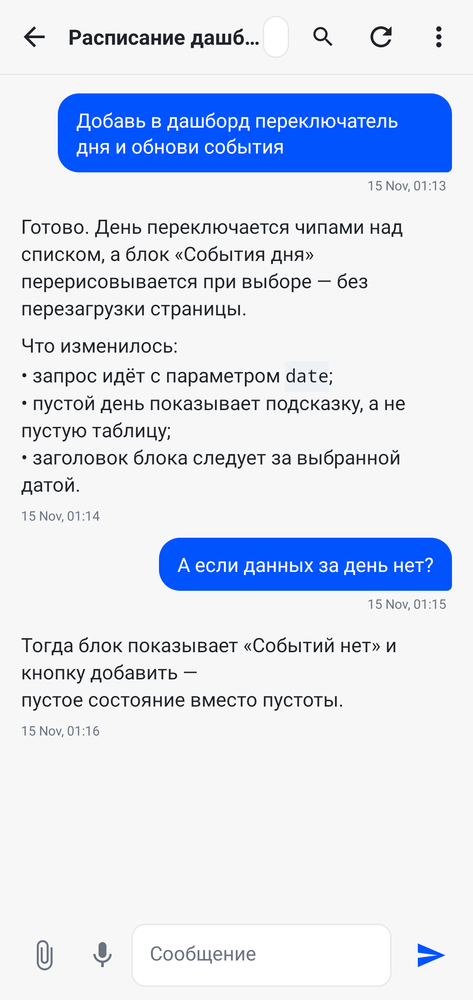
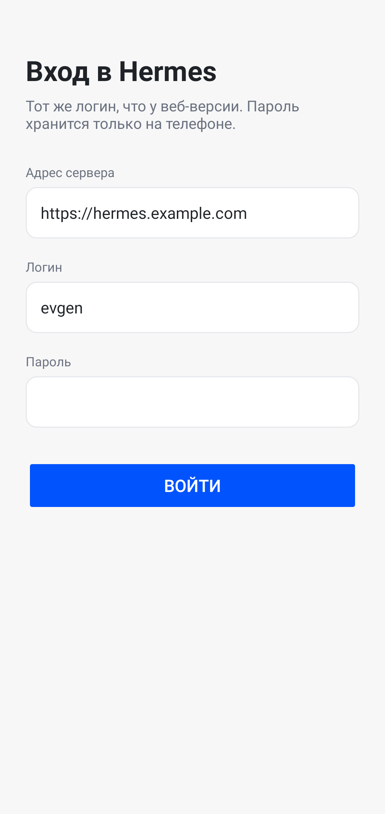

# Hermes Mobile (Android)

Нативный Android-клиент для **Hermes Agent** — агента, который живёт на вашем
собственном сервере. Не обёртка над браузером: приложение само ходит в HTTP API
Hermes и держит WebSocket, поэтому у него нормальные push-уведомления, работа в
фоне и настоящая лента чата, а не iframe.

```
Android (Kotlin)  ──HTTP + WS──▶  Hermes webapp API (:9120)  ──▶  agent, sessions, tools
                  ──HTTP──────▶  Kanban WebUI (опционально)
```

<p align="center">
  
  
  
</p>

Скриншоты — не макеты: их рисует `ScreenshotTest`, который на JVM разворачивает
настоящие layout'ы приложения и сохраняет PNG (`./gradlew testDebugUnitTest
--tests ru.evgen.hermes.ScreenshotTest`). Данные в них выдуманы, переписки
пользователя в репозиторий не попадают.

## Что умеет

- **Сессии** — список с фильтром по проекту, архив, поиск по всей истории,
  отметки прочитанного.
- **Чат** — потоковый ответ по WebSocket (`assistant.delta`), инструменты и
  результаты видны в ленте, markdown и код с подсветкой, картинки и файлы.
- **Управление прогоном** — отправить, остановить, «steer» (вместо остановки
  дописать агенту указание по ходу), очередь из нескольких сообщений.
- **Слэш-команды** и смена модели/профиля прямо из чата.
- **Уведомления** — три канала: статус «работаю» (LOW), ответ (DEFAULT), запрос
  ввода (HIGH). Плюс Live Update на Android 16+ и виджет на домашнем экране.
- **Фон** — опциональный foreground-сервис досматривает прогон и присылает
  ответ, даже если приложение закрыто.
- **Файлы** — отправка любых файлов, не только картинок.
- **Kanban** — доска из [Kanban WebUI](https://github.com/PriuS2/HermesKanban)
  в мобильном виде: колонки как вкладки, перемещение карточки долгим нажатием.
- **Голосовой ввод** в композер.
- **Самообновление** — читает `/version.json` рядом с webapp и ставит новый APK
  (через Shizuku без экрана установщика, если он есть).

## Требования

1. **Hermes Agent** на сервере, версия **0.23.x** (проверено на 0.23.3). В
   `~/.hermes/config.yaml`:

   ```yaml
   webapp:
     enabled: true
     host: 0.0.0.0
     port: 9120
     public_url: https://hermes.example.com
   ```

2. **HTTPS снаружи.** Приложение требует `https://` (Android блокирует cleartext
   по умолчанию). Подойдёт Caddy/nginx/NPM с сертификатом.

3. **Логин.** Приложение логинится той же учётной записью, что и веб-панель
   Hermes; пароль не хранится, остаются только cookies.

Kanban-раздел опционален: без токена он просто не откроется.

## Сборка

Нужны JDK 17 и Android SDK 36 (`compileSdk 36`, `minSdk 24`, `targetSdk 34`).

```bash
./gradlew assembleDebug        # debug-сборка, ставится рядом с release
./gradlew testDebugUnitTest    # 13 классов тестов на JVM (Robolectric)
```

Release без ключа соберётся **неподписанным** — это нормально для форка.
Свой ключ кладётся в `keystore.properties` в корне:

```properties
storeFile=my-release.jks
storePassword=…
keyAlias=…
keyPassword=…
```

Ключ и `keystore.properties` в git не попадают (см. `.gitignore`).

Сменить `applicationId`, не трогая код:

```bash
./gradlew assembleRelease -PappId=dev.example.hermes
```

### Релизы

`.github/workflows/build.yml` на каждый push гоняет тесты и собирает debug APK
артефактом. `.github/workflows/release.yml` на тег `v*` собирает release и
прикладывает APK + sha256 к черновику релиза. Чтобы APK был подписан, в
Settings → Secrets → Actions нужны два секрета:

| Секрет | Значение |
|---|---|
| `ANDROID_KEYSTORE_BASE64` | `base64 -w0 my-release.jks` |
| `ANDROID_KEYSTORE_PROPERTIES` | содержимое `keystore.properties` |

Без них job остаётся зелёным и отдаёт неподписанный APK.

## Первый запуск

Экран входа спрашивает три вещи: адрес сервера (`https://hermes.example.com`),
логин и пароль. Адрес запоминается в настройках приложения; сменить его можно
там же, в меню.

## Чего здесь нет

Приложение — клиент, а не сервер: без запущенного Hermes оно бесполезно. Оно
также **не** использует OpenAI-совместимый API (`:8642`), а работает с webapp-API
панели (`:9120`) — это тот же интерфейс, что у веб-панели и TUI.

## Совместимость

`/api/*` панели Hermes — внутренний контракт, а не публичный API. Он меняется
между версиями агента, поэтому:

| Hermes Agent | Приложение |
|---|---|
| 0.23.x | работает (проверено 0.23.3) |
| новее | не проверено; сначала смотрите `CHANGELOG` Hermes |

Если после обновления Hermes приложение перестало грузить сессии — почти всегда
дело в изменившейся ручке, а не в телефоне.

## Лицензия

MIT — см. [LICENSE](LICENSE). Проект не связан с Nous Research; Hermes Agent
распространяется отдельно под MIT.

---

## English

Native Android client for a self-hosted **Hermes Agent**. Talks to the Hermes
webapp API (`:9120`, HTTP + WebSocket) — sessions, streaming chat, tool output,
run control, notifications, file upload, kanban board, voice input, self-update.

Requires Hermes Agent 0.23.x with `webapp.enabled: true` behind HTTPS. Build with
JDK 17 + Android SDK 36: `./gradlew assembleDebug`. Release builds without a
keystore are unsigned by design; drop your own `keystore.properties` next to the
project to sign them. Override the app id with `-PappId=dev.example.hermes`.

The `/api/*` endpoints are Hermes' internal webapp contract, not a public API —
pin the agent version you test against. MIT licensed, not affiliated with Nous
Research.
